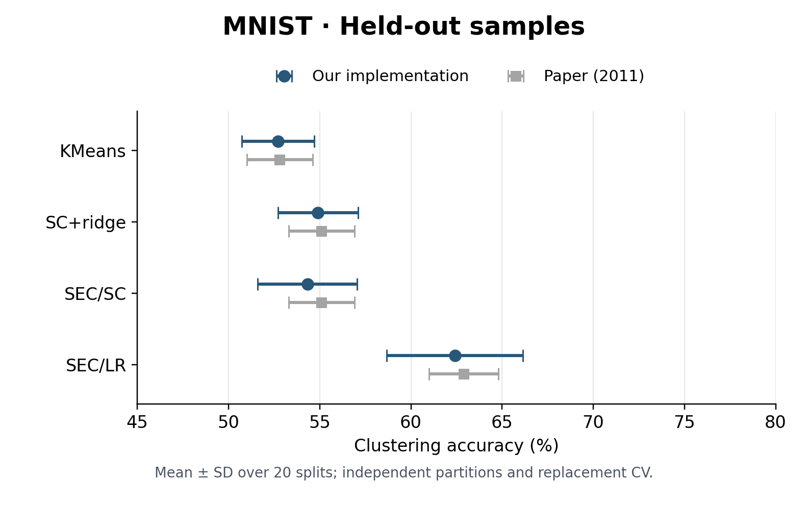

# Spectral Embedded Clustering: MNIST Reproduction

Independent Python reproduction of Nie et al., **Spectral Embedded Clustering: A Framework for In-Sample and Out-of-Sample Spectral Clustering**, *IEEE Transactions on Neural Networks*, 2011. [Paper / DOI](https://doi.org/10.1109/TNN.2011.2162000).

## Repository structure

```text
run_mnist.py       Download, run the experiment and summarize new results
sec/model.py      SEC/SC and SEC/LR algorithms
sec/cv_cache.py   Reuse training-fold computations during parameter selection
sec/data.py       MNIST download and checksum verification
sec/metrics.py    Clustering accuracy with Hungarian label alignment
requirements.txt  Runtime dependencies
results/mnist/    Previously completed 20-split results
figures/          Comparison with the paper
```

## 1. Reproduction code

The experiment compares **KMeans, SC+ridge, SEC/SC and SEC/LR**. SEC combines local structure with global regression to cluster training samples and predict clusters for unseen samples. SC+ridge uses SEC/SC with μ = 0.

Use Python **3.10–3.13** and run from the repository root:

```bash
python3.13 -m venv .venv
source .venv/bin/activate
pip install -r requirements.txt
python run_mnist.py
```

The script automatically downloads the [Keras-distributed MNIST archive](https://github.com/keras-team/keras/blob/master/keras/src/datasets/mnist.py), verifies its SHA-256, and runs **20 random splits with 50 initializations per fit**. It writes **newly computed results** to `outputs/mnist/`:

- `runs.csv`: train/test ACC and selected μ for each split and method.
- `summary.csv` and `summary.md`: mean ± sample SD, also printed when complete.
- `progress.json`: settings, completed results and CV scores for resuming.

A full run performs 920 fits, including inner CV, and can take substantial CPU time. Resume completed methods with `python run_mnist.py --resume`; an interrupted method is rerun. Use `--output outputs/another_run` for a fresh run. A shorter check is `python run_mnist.py --splits 1 --n-init 3 --output outputs/check`; this is not the published 20-split result, and a single split has no SD.

**Protocol:** concatenate all 70,000 images, retain raw 0–255 pixels, and use 3,500 training / 66,500 test samples per split. Seeds are `20261029 + split`. SEC selects μ from `1e-9, 1e-6, 1e-3, 1, 1e3, 1e6, 1e9` by three-fold CV using training-internal validation labels; outer test data do not enter selection. Initializations are selected by optimization objective. SC uses a union 5-neighbor graph and seventh-neighbor scale; LR uses the center plus four neighbors.

**Environment for the saved results:** CPU execution, one numerical-library thread per fit; Python **3.10.12**, NumPy **2.1.3**, SciPy **1.15.3**, scikit-learn **1.6.1**, OpenBLAS **0.3.27**. Local refactoring checks used Python 3.13.5 on macOS. Floating-point results can vary across platforms; NumPy runtime warnings observed in the local environment did not prevent the checked numerical comparisons from passing.

## 2. Reproduction results

The bundled results were generated on **2026-10-30**, before this entry-point simplification. Entries are **mean ± standard deviation (%)** over all 20 random splits; our SD uses `ddof=1`. Paper references are from Tables II and III. SC+ridge corresponds to SC for training and SEC/SC (μ → 0) for testing.

| Method | Our train ACC | Paper train ACC | Our test ACC | Paper test ACC |
|---|---:|---:|---:|---:|
| KMeans | 52.99 ± 2.34 | 53.2 ± 2.3 | 52.71 ± 1.99 | 52.8 ± 1.8 |
| SC+ridge | 61.62 ± 3.23 | 61.7 ± 2.5 | 54.90 ± 2.20 | 55.1 ± 1.8 |
| SEC/SC | 59.00 ± 5.40 | 61.7 ± 2.5 | 54.32 ± 2.74 | 55.1 ± 1.8 |
| SEC/LR | 69.66 ± 5.09 | 71.0 ± 2.5 | 62.41 ± 3.74 | 62.9 ± 1.9 |

**The SEC test means are close to the paper:** SEC/SC is **0.78 percentage points** lower and SEC/LR is **0.49 points** lower. The method ordering agrees; training means differ more and our variability is larger. This is numerical agreement, not statistical equivalence.



*Mean ± SD; error bars are not confidence intervals. [Training comparison](figures/mnist_train.png) · [Saved per-split scores](results/mnist/runs.csv) · [Saved summary](results/mnist/summary.csv).*

MNIST was selected from completed experiments as a teaching case with close test means; no split was discarded. Author preprocessing and full CV details were not recovered, so this uses an explicit replacement CV protocol and is not an exact or official reproduction. The core SEC implementation is unchanged; the compact runner and SEC-only cache were checked against the original pipeline on small inputs, without repeating the full benchmark.

No software license has been selected. Dataset files, model archives and the paper PDF are not bundled.
