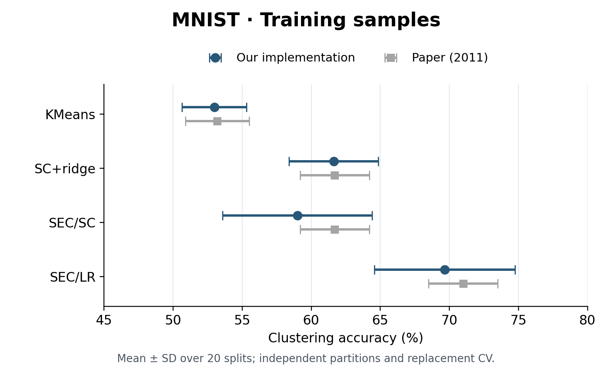

# Spectral Embedded Clustering: MNIST reproduction

An independent Python implementation of **Spectral Embedded Clustering: A Framework for In-Sample and Out-of-Sample Spectral Clustering**, Nie et al., *IEEE Transactions on Neural Networks*, 22(11), 1796–1808, 2011. [Paper / DOI](https://doi.org/10.1109/TNN.2011.2162000) · [Publication record](https://opus.lib.uts.edu.au/handle/10453/29713).

This course repository presents **one MNIST experiment**: SEC/SC, SEC/LR and two simple baselines, using all 20 existing random splits. MNIST was selected from the completed experiments as a compact teaching example with test means close to the paper; it is not evidence that every dataset was reproduced equally closely. This is an independent implementation, not official author code or an exact numerical reproduction.

## Method

SEC combines a local structure term with a global regression term. It computes a spectral embedding for training samples, discretizes it by spectral rotation, and learns an affine predictor for unseen samples.

- **SEC/SC:** local structure is a normalized graph Laplacian.
- **SEC/LR:** local structure is derived from local ridge regressions.
- **SC+ridge:** SC with SEC's regression extension, implemented by setting μ to zero. It corresponds to SC in paper Table II and SEC/SC (μ → 0) in Table III.
- **KMeans:** clustering and nearest-center prediction as a baseline.

[`sec/model.py`](sec/model.py) contains the core implementation. Arrays use samples in rows, and predictions are cluster IDs.

## Results and comparison with the paper

The results below were generated on **2026-10-30**. Each entry is **mean ± standard deviation**, in percent, over 20 random partitions. Our SD uses `ddof=1`. Paper references were checked against the MNIST rows of Tables II and III. All splits are retained; no best seed is selected.

| Method | Our train ACC | Paper train ACC | Our test ACC | Paper test ACC |
|---|---:|---:|---:|---:|
| KMeans | 52.99 ± 2.34 | 53.2 ± 2.3 | 52.71 ± 1.99 | 52.8 ± 1.8 |
| SC+ridge | 61.62 ± 3.23 | 61.7 ± 2.5 | 54.90 ± 2.20 | 55.1 ± 1.8 |
| SEC/SC | 59.00 ± 5.40 | 61.7 ± 2.5 | 54.32 ± 2.74 | 55.1 ± 1.8 |
| SEC/LR | 69.66 ± 5.09 | 71.0 ± 2.5 | 62.41 ± 3.74 | 62.9 ± 1.9 |

**Our held-out SEC results are close to the paper's reported means:** SEC/SC achieves **54.32% versus 55.1%** (0.78 percentage points lower), and SEC/LR achieves **62.41% versus 62.9%** (0.49 points lower). Both reproduce the reported ordering: SEC/LR performs better than SEC/SC on MNIST. This is descriptive numerical agreement, not a claim of statistical equivalence.


*Mean ± SD for our complete 20-split experiment and the paper. Our partitions were generated independently; the authors' split indices were unavailable. Error bars are not confidence intervals.*



*Training results are shown separately: SEC/SC is 59.00% versus 61.7%, and SEC/LR is 69.66% versus 71.0%. Our observed variability is larger. The closeness claim above concerns the test means, not identical distributions or training scores.*

[Per-split scores](results/mnist/runs.csv) · [Summary CSV](results/mnist/summary.csv) · [Paper values](results/mnist/paper_reference.json). SVG/PDF copies of both figures are in [`figures/`](figures/).

## Actual experiment environment

These are the versions used to generate the reported results, as saved in the experiment configurations:

| Component | Experiment setting |
|---|---|
| Execution | CPU, one numerical-library thread per fit; no GPU training |
| Python | 3.10.12 |
| NumPy | 2.1.3 |
| SciPy | 1.15.3 |
| scikit-learn | 1.6.1 |
| BLAS | OpenBLAS 0.3.27, recorded in the full-run resource report |
| Available logical CPUs | 16, recorded in the full-run resource report |
| Operating system | Linux x86_64; the same environment's preceding record reports kernel 5.15.0-191-generic and glibc 2.35 |

The OS record was captured one day before the full run; the run configuration itself does not record OS or CPU model. A specific CPU model is therefore not asserted. [Environment evidence](docs/EXPERIMENT_ENVIRONMENT.json) distinguishes these sources. **Local packaging checks used macOS and Python 3.13.5**, not the result-generating environment; their [package list](docs/VALIDATION_ENVIRONMENT.txt) and [verification notes](docs/VERIFICATION.md) are separate.

## Install and verify

Use Python 3.10–3.13. Run from the repository root:

```bash
python3.13 -m venv .venv
source .venv/bin/activate
python -m pip install -r requirements-data.txt
python demo.py
python -m pytest -q
python make_figures.py
```

Replace `python3.13` with the path to an installed Python 3.10–3.13 interpreter if needed. The pinned original dependencies are not intended for Python 3.14. `demo.py` is a small generated-data fit/predict check, not another reported experiment. `make_figures.py` rebuilds the MNIST comparison from saved scores without training. The retained suite has 49 tests; local environment warnings are documented in the verification notes.

## Data and optional rerun

The preparation script downloads the [MNIST archive distributed by Keras](https://github.com/keras-team/keras/blob/master/keras/src/datasets/mnist.py), verifies its SHA-256, concatenates the original 60,000 training and 10,000 test images, and flattens each 28×28 image into 784 raw pixel values. No dataset or paper PDF is included. See [data preparation](DATASETS.md).

```bash
python prepare_datasets.py mnist
```

The experiment uses **3,500 seen samples (5%) and 66,500 unseen samples (95%)** per random partition of the full 70,000 images. This is not the standard 60,000/10,000 classification split. Optional commands to rerun the declared protocol:

```bash
python run_benchmark.py --datasets mnist --methods KMeans SC+ridge \
  --splits 20 --n-init 50 --seed 20261029 --threads 1 \
  --output outputs/mnist_fixed

python run_cv_benchmark.py --datasets mnist --methods SEC/SC SEC/LR \
  --splits 20 --cv-folds 3 --n-init 50 --seed 20261029 --threads 1 \
  --output outputs/mnist_cv
```

These are computationally substantial runs and were **not re-executed for packaging**. Use fresh output folders; add `--resume` only with identical source, data and settings. The runners save configuration, splits, metrics, predictions and models. Dense eigenproblems use quadratic memory and roughly cubic time in the training sample count. Floating-point outcomes can vary across platforms.

## Protocol and reproduction boundary

- Outer partitions are non-stratified, using seeds `20261029 + split` for split 0–19. All four methods share them and use 50 initializations per fit, selected by optimization objective rather than ground-truth ACC.
- SEC selects μ using shuffled, non-stratified 3-fold CV inside the seen data. The MNIST grid is `1e-9, 1e-6, 1e-3, 1, 1e3, 1e6, 1e9`; the largest mean validation ACC wins, with the first candidate on an exact tie.
- **Inner validation labels are used for tuning; outer test features and labels do not enter SEC selection.** This is an explicit replacement for the authors' incompletely specified CV, not a recovery of their exact procedure. Original author data matrices and preprocessing were not authenticated.
- Inputs retain raw 0–255 pixels. Centering uses the relevant training partition. SC uses a symmetric union 5-neighbor graph with seventh-neighbor self-tuning scale; LR uses the center plus four neighbors. These are explicit implementation conventions.
- ACC uses an independent Hungarian label alignment for each evaluated partition, not a fixed-label classification mapping. Training `labels_` discretize the spectral embedding; `predict(X)` uses its regression approximation.

## Files and attribution

| Location | Purpose |
|---|---|
| `sec/` | Unchanged SEC implementation and supporting baseline/CV utilities |
| `demo.py`, `tests/` | Lightweight verification |
| `prepare_datasets.py` | Data acquisition and provenance |
| `run_benchmark.py`, `run_cv_benchmark.py` | Experiment entry points |
| `results/mnist/` | This single experiment's scores, reference values and original configs |
| `make_figures.py`, `figures/` | Reproducible figures and table |
| `docs/` | [Provenance](docs/PROVENANCE.md), environment and verification |

The copied core and experiment code are unchanged. Supporting code retains its existing generic dataset/method options, but this repository's presentation includes only the MNIST case study.

Codex/AI assistance was used in implementation/tooling development and checks, and in preparing documentation, packaging and figures. This is not a claim of unaided student authorship or of compliance with an unspecified course AI policy. No software license has been selected; dataset and paper rights remain with their owners.

```bibtex
@article{nie2011spectral,
  author = {Nie, Feiping and Zeng, Zinan and Tsang, Ivor W. and Xu, Dong and Zhang, Changshui},
  title = {Spectral Embedded Clustering: A Framework for In-Sample and Out-of-Sample Spectral Clustering},
  journal = {IEEE Transactions on Neural Networks},
  year = {2011}, volume = {22}, number = {11}, pages = {1796--1808},
  doi = {10.1109/TNN.2011.2162000}
}
```
