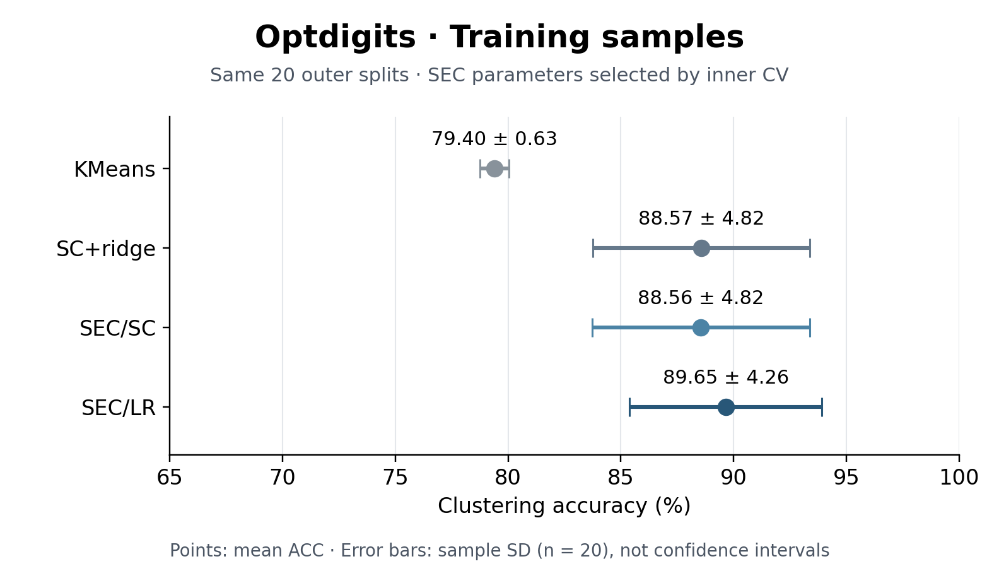
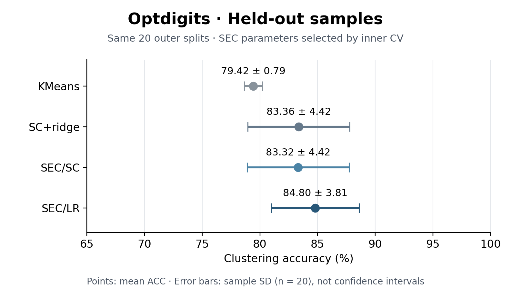

# Spectral Embedded Clustering (SEC)

An independent Python implementation and reproduction of **Spectral Embedded Clustering: A Framework for In-Sample and Out-of-Sample Spectral Clustering**, Nie et al., *IEEE Transactions on Neural Networks*, 22(11), 1796–1808, 2011. [Paper / DOI](https://doi.org/10.1109/TNN.2011.2162000) · [Author publication record](https://opus.lib.uts.edu.au/handle/10453/29713).

This course project demonstrates SEC/SC and SEC/LR, including spectral rotation and prediction for unseen samples. **It is not the authors' official code, and it does not claim an exact numerical reproduction.** Optdigits is the main example; an eight-dataset result table is included as a supplement.

## What SEC does

Standard spectral clustering constructs an embedding for the training samples but does not directly provide a function for new samples. SEC combines a local structure term with a global regression term. The embedding is obtained from the smallest eigenvectors, discretized by spectral rotation, and approximated by a learned affine predictor for unseen samples.

- **SEC/SC:** local structure comes from a normalized spectral graph Laplacian.
- **SEC/LR:** local structure comes from local ridge regressions.
- **SC+ridge:** SC embedding with the same regression extension, implemented by setting SEC's coupling parameter μ to zero.
- **KMeans:** a simple comparison baseline, predicting with the nearest fitted center.

The core implementation is in [`sec/model.py`](sec/model.py). Input arrays use samples in rows. Predictions are cluster IDs, not semantic class labels.

## Install and run a small example

Run from the repository root. Use Python 3.10–3.13; the original experiment used Python 3.10.12 and the release checks used Python 3.13.5. A fresh environment is recommended.

```bash
python3.13 -m venv .venv
source .venv/bin/activate
python -m pip install -r requirements-data.txt
python demo.py
python -m pytest -q
```

`demo.py` runs both SEC variants on 300 generated samples, reports train/test ACC and eigen residuals, and needs no download. It checks the fitting/prediction path; its scores are not the Optdigits results below. The test suite checks the mathematical operators, prediction and save/load behavior, CV selection boundary, and cached/direct equivalence on small inputs.

Use the equivalent path to your Python 3.10–3.13 interpreter if it is not named `python3.13`. The pinned original dependencies are not intended for Python 3.14.

## Main result: Optdigits

All scores below come from the completed **2026-10-30 experiment**, using 20 shared random outer splits, 3,372 training and 2,248 held-out samples per split, and 50 initializations per fit. SEC uses 3-fold CV inside the training set; KMeans and SC+ridge are fixed baselines. Entries are **mean ± sample standard deviation**, in percentage points.

| Method | Train ACC (%) | Test ACC (%) |
|---|---:|---:|
| KMeans | 79.40 ± 0.63 | 79.42 ± 0.79 |
| SC+ridge | 88.57 ± 4.82 | 83.36 ± 4.42 |
| SEC/SC | 88.56 ± 4.82 | 83.32 ± 4.42 |
| SEC/LR | 89.65 ± 4.26 | 84.80 ± 3.81 |



*Training embedding quality: SEC/LR has the highest mean among these four methods. Error bars show variation across all 20 splits; no seed was selected for display.*



*Unseen-sample prediction: SEC/LR has the highest held-out mean among these four methods. SEC/SC and SC+ridge are very close. These descriptive comparisons do not establish statistical significance. Error bars are standard deviations, not confidence intervals.*

The paper reports Optdigits test means of **86.00% for SEC/SC and 90.00% for SEC/LR**, compared with **83.32% and 84.80%** here. The author data matrices, preprocessing and full CV details have not been recovered, so the cause of this gap is not established.

The [80 per-split scores](results/optdigits/runs.csv), [numeric summary](results/optdigits/summary.csv), and [eight-dataset supplement](results/supplement/README.md) are included. Regenerate the presentation table and figures without fitting models:

```bash
python make_figures.py
```

Editable SVG and vector PDF versions are in [`figures/`](figures/).

## Data and optional experiment reproduction

Download the full [UCI Optdigits dataset](https://archive.ics.uci.edu/dataset/80/optical+recognition+of+handwritten+digits), containing 5,620 samples, 64 features and 10 classes. The loader concatenates `optdigits.tra` then `optdigits.tes`, retains raw 0–16 features, and creates new random seen/unseen splits. **This is not the original UCI classification split.** Data files are downloaded locally and are not included in Git.

```bash
python prepare_datasets.py optdigits
```

The following commands reproduce the main table's protocol. They are optional, computationally substantial experiments; they were **not rerun when preparing this repository**. Keep the two output folders distinct and use new folders for new configurations.

```bash
python run_benchmark.py --datasets optdigits --methods KMeans SC+ridge \
  --splits 20 --n-init 50 --seed 20261029 --threads 1 \
  --output outputs/optdigits_fixed

python run_cv_benchmark.py --datasets optdigits --methods SEC/SC SEC/LR \
  --splits 20 --cv-folds 3 --n-init 50 --seed 20261029 --threads 1 \
  --output outputs/optdigits_cv
```

Each runner writes configurations, per-split metrics, model checkpoints and predictions. Add `--resume` only with identical data, source and settings. Reproduction means rerunning the declared protocol; different Python/BLAS platforms need not yield identical floating-point results. Dense eigenproblems use quadratic memory and roughly cubic time in the number of training samples.

## Protocol and limits

- Outer seeds are `20261029 + split`, for split indices 0–19, with non-stratified random 60/40 partitions on Optdigits.
- Inner CV uses shuffled, non-stratified 3-fold KFold, mean validation clustering ACC, and the first candidate on an exact tie. SEC's μ grid is `1e-9, 1e-6, 1e-3, 1, 1e3, 1e6, 1e9, 1e12, 1e15`.
- **Inner validation labels select parameters. Outer test features and labels do not enter SEC selection.** This is an explicit replacement for the authors' incompletely specified CV procedure, not fully label-free tuning.
- Features remain raw; centering and fitted transformations use the applicable training partition. The SC graph uses a symmetric union of 5-neighbor edges, with self-tuning scale at the seventh other neighbor. LR uses the center plus four neighbors; these unresolved conventions are disclosed implementation choices.
- All 50 initializations are compared by the optimization objective, not by ground-truth ACC. Every outer split is retained. Clustering ACC uses a separate Hungarian label alignment on each evaluation partition; it is not fixed-label classification accuracy.
- Training `labels_` discretize the fitted spectral embedding. `predict(X)` uses its regression approximation, so `predict(X_train)` need not equal `labels_`.
- This release contains one protocol's results. Historical fixed-μ sweeps are excluded. Nyström code remains as supporting baseline functionality, but Nyström results are excluded: the original full run used test-label bandwidth selection on five datasets, which is an oracle comparison rather than independent test evaluation.

See [data sources](DATASETS.md), [result provenance and release scope](docs/PROVENANCE.md), and [verification](docs/VERIFICATION.md).

## Project structure

```text
sec/                    SEC, baselines, metrics, CV and checkpoint utilities
demo.py                 Small offline fit/predict example
prepare_datasets.py     Download and prepare documented datasets
run_benchmark.py        Fixed baseline experiments
run_cv_benchmark.py     Training-only parameter selection and final fits
paper_protocol.py       Dataset settings and paper reference numbers
make_figures.py         Rebuild figures and table from saved scores
tests/                  Selected existing mathematical/protocol tests
results/optdigits/      Main scores and original configuration records
results/supplement/     Eight-dataset summary and per-split scores
figures/                PNG, SVG and PDF figures
docs/                   Provenance, source hashes and release verification
```

## AI assistance and reuse

Codex/AI assistance was used in developing and checking the implementation and experiment tooling, and in preparing this repository, documentation and figures. This is not a claim of unaided student authorship. The repository does not assert compliance with an unspecified course AI policy; any required course disclosure should accompany the submission.

No software license has been selected for this repository. Dataset and paper rights remain with their respective owners; neither the paper PDF nor dataset files are bundled.

## Citation

```bibtex
@article{nie2011spectral,
  author = {Nie, Feiping and Zeng, Zinan and Tsang, Ivor W. and Xu, Dong and Zhang, Changshui},
  title = {Spectral Embedded Clustering: A Framework for In-Sample and Out-of-Sample Spectral Clustering},
  journal = {IEEE Transactions on Neural Networks},
  year = {2011},
  volume = {22},
  number = {11},
  pages = {1796--1808},
  doi = {10.1109/TNN.2011.2162000}
}
```
